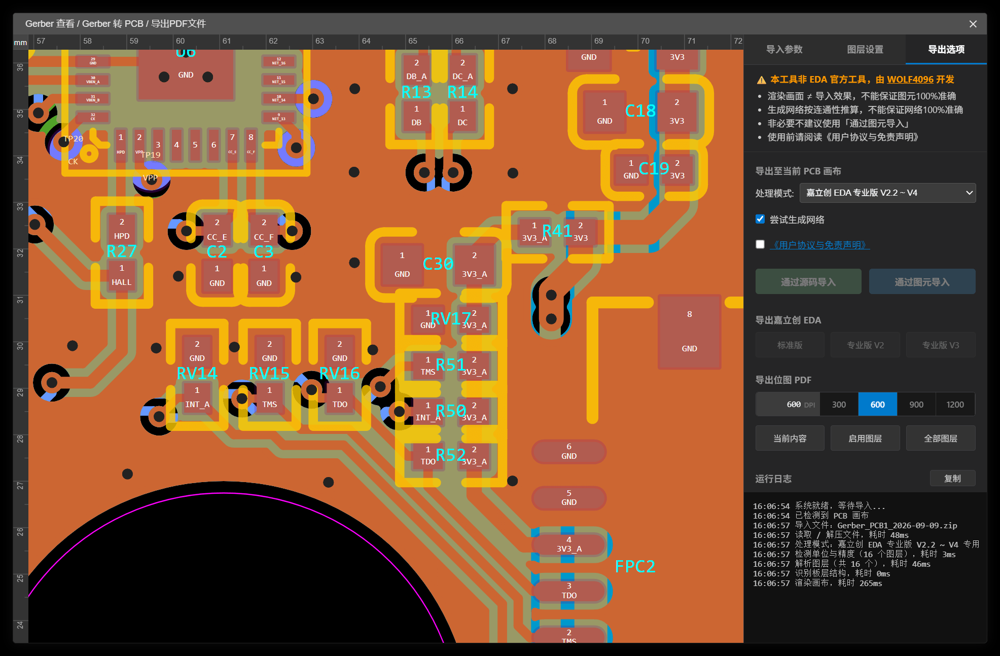
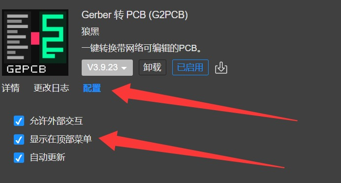

# 狼黑工具 · Gerber 转 PCB (G2PCB)

## 一键转换带网络可编辑的PCB。

**把 Gerber 制造文件 转成 嘉立创 EDA 的 PCB 文件，或直接写进当前 PCB 画布，带网络属性。**

**支持客户端版本：嘉立创 EDA 专业版 V2.2.45 ~ V4.x.x，推荐 V3.2.135 以上**

全程离线运行，文件解析、渲染、导出都在本地完成，不上传任何服务器。

**[打开 Github 演示页面](https://wolf4096.github.io/eext-gerber-import-tool/iframe/ImportGerber.html)
| [演示视频](https://pbt-pub.jlc.com/pbt/bbs/8707762781426302976-20260205_220643.mp4)**

---

## 简介

这是一个嘉立创 EDA 专业版扩展，装在 EDA 里就能用，主要做三件事：

- **解析** Gerber 制造文件（线路、阻焊、丝印、钻孔等各层）；
- **转换**成嘉立创 EDA 专业版 / 标准版的 PCB 文件；
- **导入**到当前 PCB 画布，继续编辑；

适用场景：个人学习、电路研究、旧板维修参考、自有设计文件的格式互转。  
生成的结果**仅供参考**，投入生产前请务必人工复核。

---

## 安装

### V3 / V4（推荐）

**建议在线安装**

1. 打开嘉立创 EDA 专业版，在菜单栏「高级 → 扩展管理器」，搜索「Gerber 转 PCB (G2PCB)」，点「安装」。
2. 在「已安装」扩展列表里找到「Gerber 转 PCB (G2PCB)」，点「配置」 → 勾选 **允许外部交互** 与 **显示在顶部菜单**。

**离线安装**

1. 下载插件：【[扩展广场下载](https://jlc-ext.com/item/darksteel/eext-gerber-import)】或【[Github下载](https://github.com/WOLF4096/eext-gerber-import-tool/releases)】
2. 打开嘉立创 EDA 专业版，在菜单栏「高级 → 扩展管理器」 → 点「导入」，选择下载好的 `.eext` 文件
3. 在「已安装」扩展列表里找到「Gerber 转 PCB (G2PCB)」，点「配置」 → 勾选 **允许外部交互** 与 **显示在顶部菜单**。

> 第 3 步很关键。不勾「显示在顶部菜单」，装完在菜单栏是看不到的。

### V2.2.45

1. 下载插件：【[扩展广场下载](https://jlc-ext.com/item/darksteel/eext-gerber-import)】或【[Github下载](https://github.com/WOLF4096/eext-gerber-import-tool/releases)】
2. 打开嘉立创 EDA 专业版，在菜单栏「设置 → 扩展 → 扩展管理器 → 导入扩展」 → 选择 `.eext` 文件；
3. 装好后勾选「允许外部交互」，V2.2.45 默认在菜单栏显示。

> V2.2.45 不支持快捷键。项目本身基于 V2.2.45 开发，全部功能可用；早期 API 不够完善，可能会有兼容性问题。

## 使用方法

### 1. 打开工具

在嘉立创 EDA 专业版中打开或新建一个 **PCB 文档**，从顶部菜单 **「Gerber工具 → 导入Gerber」** 进入。

> 首页、原理图页、符号页也能打开这个工具，但只有 PCB 文档能写入画布，其它页面只能用导出。

### 2. 导入文件（三选一）

1. **导入当前板子 Gerber 图形**：直接取当前 PCB 的 Gerber 数据；
2. **导入 Gerber 压缩包 / 文件**：选择 `.zip` 或多个 Gerber / 钻孔文件；
3. **直接拖拽**：把压缩包或文件拖到工具窗口。

### 3. 配置

- **处理模式**：`嘉立创EDA专业版` 还原最完整；其它来源选 `RS-274X（通用）`。导入后会自动识别并切换。
- **图层设置**：逐层控制显隐与颜色，查看识别出的文件名、尺寸、层数等。
- **生成网络**：勾选后按铜层连通性自动分配网络名（有飞针文件时优先采用文件里的名字）。

### 4. 写入画布/导出

- **通过源码导入**（推荐）：写入当前画布，最完整、可撤销；
- **通过图元导入**：逐个创建图元，数量大时可能卡顿；
- **导出嘉立创 EDA 专业版 / 标准版**：生成可编辑的工程文件；
- **导出位图 PDF**：按层输出，DPI 可调。

> 「通过源码导入 / 通过图元导入」只在 PCB 画布上可用；从其它页签打开时按钮会禁用，请先打开 PCB 文档。

> 导入画布功能 **建议在新建的空白 PCB 文档中使用**。

> 本工具会直接写入 EDA 画布，在已有设计的文档里操作可能覆盖原图元、且无法撤销。

---

## 支持打开哪些 Gerber 文件

| 来源                                                                   | 还原程度                   |
| ---------------------------------------------------------------------- | -------------------------- |
| **嘉立创 EDA 专业版**导出的 Gerber                                     | 最完整、最准确             |
| **RS-274X** 通用 Gerber（KiCad / Altium / PADS / Eagle / layout60 等） | 可尝试转换，兼容性不作保证 |

**导入方式**：`.zip` 压缩包、一次选中多个文件、或直接拖拽到窗口任意位置。

---

## 能转成什么格式的 PCB

| 输出方式                 | 产物                                                             | 说明                           |
| ------------------------ | ---------------------------------------------------------------- | ------------------------------ |
| **通过源码导入**（推荐） | 写入当前 PCB 画布，支持嘉立创 EDA 专业版 V2.2.45 ~ V4 版本客户端 | 还原最完整、可撤销             |
| **通过图元导入**         | 写入当前 PCB 画布，支持嘉立创 EDA 专业版 V2.2.45 ~ V4 版本客户端 | 图元多时可能卡顿，无法完全撤回 |
| **导出嘉立创 EDA**       | `.epro2`（专业版 V3）/ `.epro`（专业版 V2）/ 标准版 `.json`      | 生成工程文件，本地保存         |

---

## 支持哪些图元

| 项目              |  通过源码导入  |   通过图元导入   | 导出专业版 PCB | 导出标准版 PCB |
| :---------------- | :------------: | :--------------: | :------------: | :------------: |
| 圆形 / 矩形焊盘   |      支持      |       支持       |      支持      |      支持      |
| 异形 / 自定义焊盘 |      支持      |       支持       |      支持      |      支持      |
| 导线 / 折线       |      支持      |       支持       |      支持      |      支持      |
| 丝印 / 文字       |      支持      |       支持       |      支持      |      支持      |
| 圆弧 / 整圆       |      支持      |       支持       |      支持      |      支持      |
| 填充 / 挖槽       |      支持      |       支持       |      支持      |      支持      |
| 槽孔 / 过孔       |      支持      |       支持       |      支持      |      支持      |
| 矢量图片          |      支持      |       支持       |      支持      |      支持      |
| 埋盲孔规则        |      支持      |     暂不支持     |      支持      |     不支持     |
| 埋盲孔            |      支持      | 需先手动添加规则 |      支持      |     不支持     |
| 元件位号          | 支持（需勾选） |  支持（需勾选）  | 支持（需勾选） | 支持（需勾选） |
| 网络生成          | 支持（需勾选） |  支持（需勾选）  | 支持（需勾选） | 支持（需勾选） |
| 合并成组          |      支持      |      不支持      |      支持      |     不支持     |
| FPC 补强          |      支持      |      不支持      |      支持      |     不支持     |
| 真彩图片          |     不支持     |      不支持      |     不支持     |     不支持     |

> 网络名在四个通道中均按「尝试生成网络」复选框决定是否写入。

---

## 常见问题

**Q：某层没被认出来、多层变成单层、层名是空的或者认错了？**
在图层面板里手动指定正确的层，再重新写入。

**Q：彩色丝印不显示**
Gerber里的彩色丝印是加密数据，目前无法解密。

---

## 免责声明

- **数据安全**：纯本地运行，不上传、不收集任何设计文件。
- **结果不作保证**：工具按「现状」提供，转换结果可能存在误差，**严禁未经人工复核直接用于生产制造**。
- **风险自担**：请在空白文档中使用并提前备份；因使用本工具产生的数据丢失、返工等后果由使用者自行承担。
- **合规使用**：请确保所处理文件的来源与用途合法。

> 完整条款以工具内的《用户协议与免责声明》为准。

---

## 反馈与支持

| 项目     | 信息                                                                                                       |
| -------- | ---------------------------------------------------------------------------------------------------------- |
| 作者主页 | [狼黑](https://github.com/WOLF4096)                                                                        |
| 项目主页 | [Gerber 转 PCB](https://github.com/WOLF4096/eext-gerber-import-tool)                                       |
| 问题反馈 | [提交 Issue](https://github.com/WOLF4096/eext-gerber-import-tool/issues)（附上报错的 Gerber 样本更易定位） |
| 扩展主页 | [嘉立创 EDA 扩展广场](https://jlc-ext.com/item/darksteel/eext-gerber-import)                               |
| 开源许可 | Apache-2.0                                                                                                 |

> 本工具为非官方第三方开源扩展。
